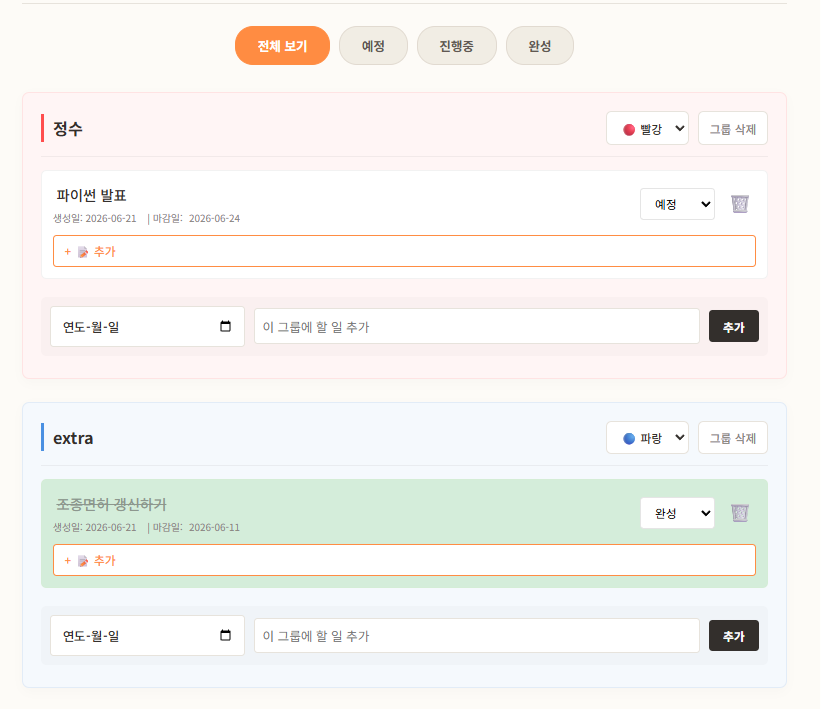
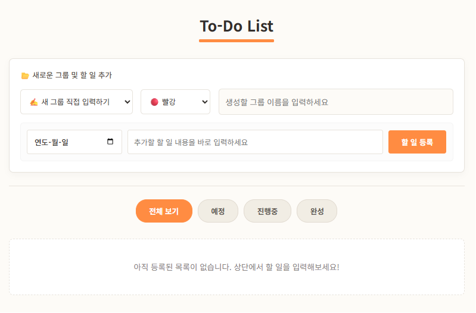
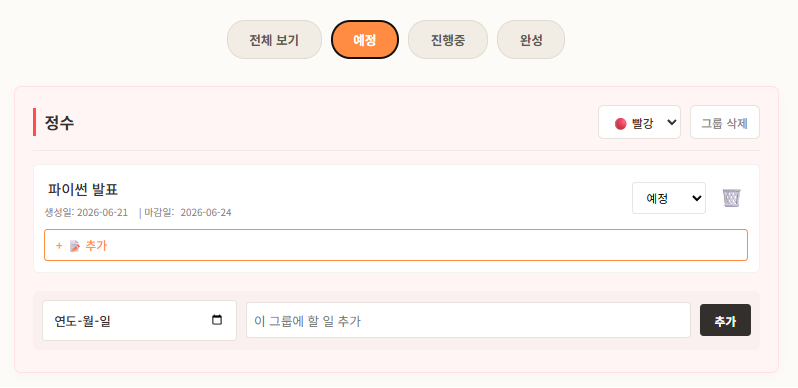
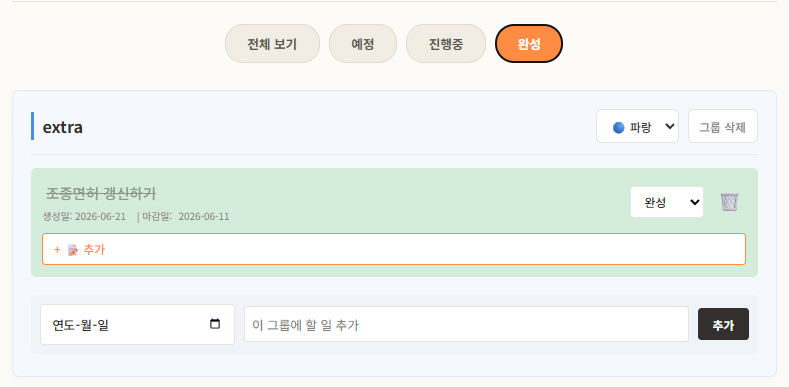

# 그룹형 To-Do List &nbsp;&nbsp;&nbsp;&nbsp;&nbsp;&nbsp;&nbsp;&nbsp;&nbsp;<small><small><small>2026.06</small></small></small>

HTML, CSS, JavaScript로 만든 그룹형 할 일 관리 웹 앱.

할 일을 그룹으로 나눠 관리하고, 할 일마다 메모를 달 수 있으며, 모든 데이터는 브라우저(localStorage)에 저장.




## 핵심 코드

### 할 일 CRUD

[script.js](script.js) · [이론 정리: 줄 편집기](https://github.com/Jenny5789/python/blob/main/study_archive/data_structures/02_line_editor.py)

줄 편집기가 한 줄씩 넣고, 고치고, 지우듯이 그룹 안의 할 일 배열을 같은 방식으로 조작.

```javascript
// 추가 (줄 편집기 insert): id, 텍스트, 상태, 마감일, 생성일, 메모를 가진 객체
const newTodo = {
    id: Date.now(),
    text: todoText,
    status: 'todo',
    dueDate: dateInput.value || null,
    createdDate: new Date().toISOString().split('T')[0],
    memo: ''
};
allTodos[groupName].todos.push(newTodo);

// 수정 (줄 편집기 replace): id로 대상을 찾아 처리
const todo = allTodos[groupName].todos.find(t => t.id === todoId);
todo.text = newText;

// 삭제 (줄 편집기 delete)
allTodos[groupName].todos = allTodos[groupName].todos.filter(t => t.id !== todoId);

// 모든 변경 뒤 저장하고 전체를 다시 그려 화면과 데이터를 일치시킴
saveAllData();
renderAllGroups();
```

### 저장과 불러오기

[script.js](script.js) · [이론 정리: 줄 편집기 save, load](https://github.com/Jenny5789/python/blob/main/study_archive/data_structures/02_line_editor.py)

줄 편집기의 save, load처럼 전체 데이터를 JSON 문자열로 바꿔 localStorage에 저장하고, 페이지를 열 때 다시 객체로 복원.

```javascript
function saveAllData() {
    const dataToSave = { todos: allTodos, groups: allGroups };
    localStorage.setItem('todoAppData', JSON.stringify(dataToSave));
}

function loadAllData() {
    const savedData = localStorage.getItem('todoAppData');
    if (savedData) {
        const data = JSON.parse(savedData);
        allTodos = data.todos || {};
        allGroups = data.groups || Object.keys(allTodos);   // 순서가 없으면 그룹 이름으로 복원
    }
    // (try-catch와 로그 출력은 생략)
}
```

## 주요 기능

| 기능 | 설명 |
|---|---|
| 그룹 관리 | 새 그룹 직접 입력 또는 그룹 미지정 목록 사용<br>그룹명 수정, 그룹 삭제, 6가지 색상 테마 |
| 할 일 관리 | 할 일 추가, 텍스트와 마감일 인라인 수정(클릭하면 입력창으로 바뀜), 삭제<br>상태(예정, 진행중, 완성) 변경, 입력한 글자는 escapeHtml로 바꿔서 표시 |
| 데이터 구조 | 그룹 이름을 키로 하는 객체에 할 일 배열과 테마를 담아 관리([list, dict](https://github.com/Jenny5789/python/blob/main/study_archive/theory/03_data_types.md)) |
| 메모 | 할 일마다 메모 추가, 수정, 삭제 |
| 상태 필터 | 전체, 예정, 진행중, 완성 탭으로 조회 |
| 자동 저장 | 변경할 때마다 브라우저에 저장 |

<details>
<summary>전체 화면 보기</summary>

| 첫 화면 | 예정 필터 |
|---|---|
|  |  |

| 완성 필터 | |
|---|---|
|  | |

</details>

## 파일 구조

```
todo_list/
├── index.html    # HTML 구조
├── style.css     # 스타일 (6가지 색상 테마)
├── script.js     # 전체 기능 로직
└── images/       # README 스크린샷
```

## 실행 방법

설치 없이 `index.html`을 브라우저로 열면 바로 실행.
