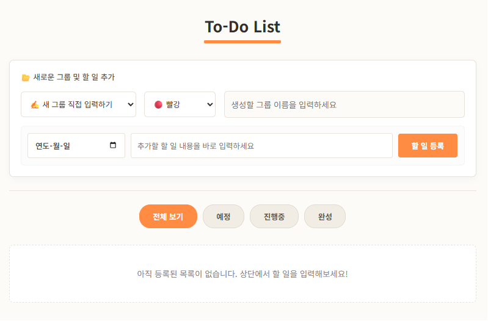
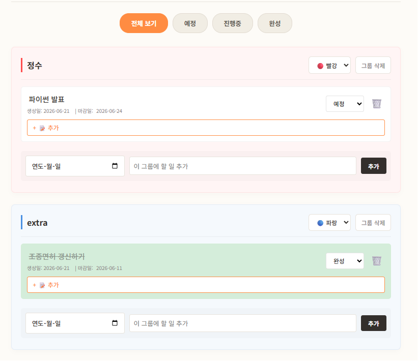
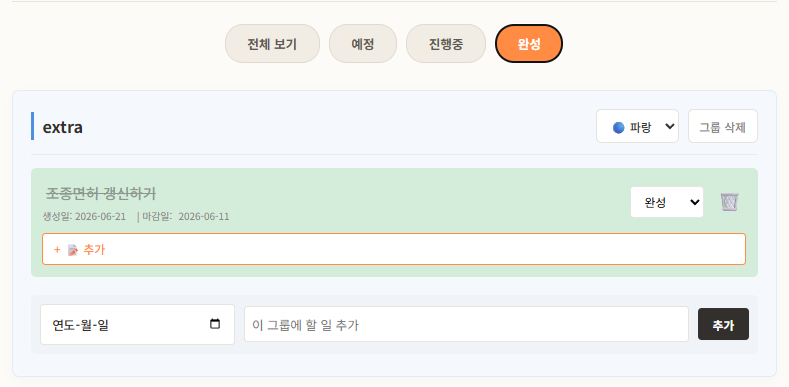
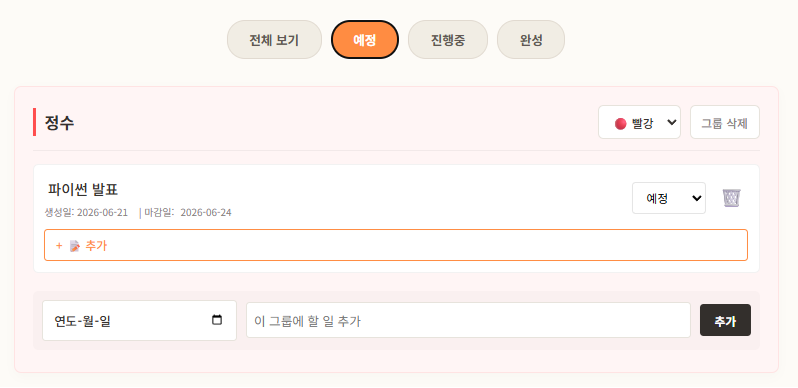

<div align="center">

# 그룹형 To-Do List

그룹·CRUD·localStorage를 Vanilla JS로 구현한 **프론트엔드 웹 앱**

`HTML5` · `CSS3` · `JavaScript (Vanilla)`



</div>

---

## 1. 프로젝트 개요

- **배경:** 프레임워크 없이 JS 기본기만으로 그룹·CRUD·저장을 직접 구현
- **목표:** 그룹별 할 일 관리, 상태 추적, 메모, 자동 저장을 하나의 화면에서 제공
- **기간:** 2026.06
- **규모:** 단일 파일 / 그룹 6가지 색상 테마 / 상태 3종

| 영역 | 기술 | 사용 이유 |
| --- | --- | --- |
| 마크업 | HTML5 | 시맨틱 구조 |
| 스타일 | CSS3 | 6가지 그룹 색상 테마, 반응형 레이아웃 |
| 로직 | JavaScript (Vanilla) | 프레임워크 없이 DOM 조작·이벤트 처리 직접 구현 |
| 저장 | localStorage | 서버 없이 브라우저 내 영구 저장 |

---

## 2. 주요 화면

| 홈 화면 | 전체 목록 |
| --- | --- |
|  |  |
| ① 그룹 목록과 할 일 추가 | ② 전체 필터로 모든 할 일 조회 |

| 완성 항목 | 예정 항목 |
| --- | --- |
|  |  |
| ③ 완성 탭 필터 | ④ 예정 탭 필터 |

---

## 3. 주요 기능

### 3-1. 그룹 관리
- 새 그룹 직접 입력, 그룹명 인라인 수정, 그룹 삭제
- 6가지 색상 테마 선택

### 3-2. 할 일 CRUD
- 할 일 추가, 텍스트·마감일 인라인 수정(클릭 시 입력창 전환), 삭제
- 상태(예정 / 진행중 / 완성) 변경

### 3-3. 메모
- 할 일마다 메모 추가, 수정, 삭제

### 3-4. 상태 필터
- 전체 / 예정 / 진행중 / 완성 탭으로 조회

### 3-5. 자동 저장
- 변경할 때마다 localStorage에 즉시 저장, 새로고침 후에도 데이터 유지

---

## 4. 문제 해결 경험

### 1) XSS 방지

- **문제:** 사용자가 입력한 텍스트를 innerHTML에 그대로 삽입하면 스크립트 실행 가능
- **원인 분석:** `innerHTML`은 HTML로 파싱되어 `<script>` 태그 등이 실행됨
- **해결:** `escapeHtml` 함수로 `<`, `>`, `&` 등 특수 문자를 엔티티로 치환 후 렌더링
- **결과:** 사용자 입력이 항상 텍스트로만 표시

### 2) 그룹 순서 보존

- **문제:** 그룹 데이터를 객체(`{}`)에 저장하면 그룹 추가 순서가 보장되지 않음
- **원인 분석:** 자바스크립트 객체는 정수형 키를 먼저 정렬하는 스펙이 있어 순서 의존 불가
- **해결:** 순서 정보를 담는 `allGroups` 배열을 별도로 유지해 렌더링 순서 제어
- **결과:** 그룹 추가·삭제 후에도 사용자가 지정한 순서 유지

### 3) localStorage 복원 실패 처리

- **문제:** 저장된 JSON이 손상됐을 때 `JSON.parse` 오류로 앱 전체가 실행되지 않음
- **원인 분석:** 브라우저 저장 공간 초과 또는 외부 수정으로 JSON 형식이 깨질 수 있음
- **해결:** `try-catch`로 감싸 오류 시 빈 상태로 초기화해 앱이 항상 실행되도록 처리
- **결과:** 데이터 손상 시에도 앱 정상 실행

---

## 5. 한계와 개선 방향

- **로컬 저장 전용:** localStorage는 같은 브라우저에서만 유효, 서버 DB 연동으로 기기 간 동기화 가능
- **단일 사용자:** 할 일 공유·협업 기능 없음
- **마감일 알림 없음:** 마감 임박 항목에 대한 알림·강조 표시 미구현

---

<details>
<summary><b>실행 방법과 파일 구조</b></summary>

<br />

설치 없이 `index.html`을 브라우저로 열면 바로 실행.

```
todo_list/
├── index.html        # HTML 구조
├── style.css         # 스타일 (6가지 색상 테마)
├── script.js         # 전체 기능 로직
└── images/           # README 스크린샷
```

</details>

---

## 6. 프로젝트를 통해 얻은 경험

- **데이터 구조 설계:** 그룹을 객체 키로, 순서를 별도 배열로 분리해 순서 보존과 빠른 조회를 함께 해결
- **보안 처리:** 사용자 입력을 innerHTML에 삽입하기 전 이스케이프 처리해 XSS 방지 적용
- **방어적 저장:** try-catch로 localStorage 복원 실패를 처리해 데이터 손상 시에도 앱 안정성 유지
